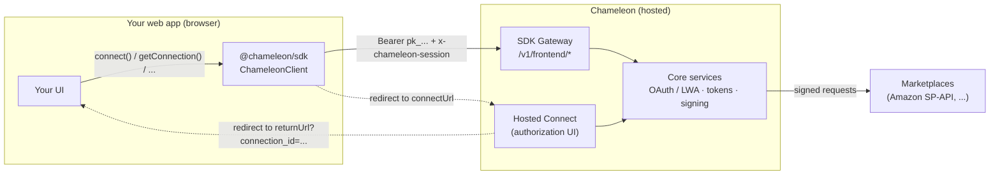
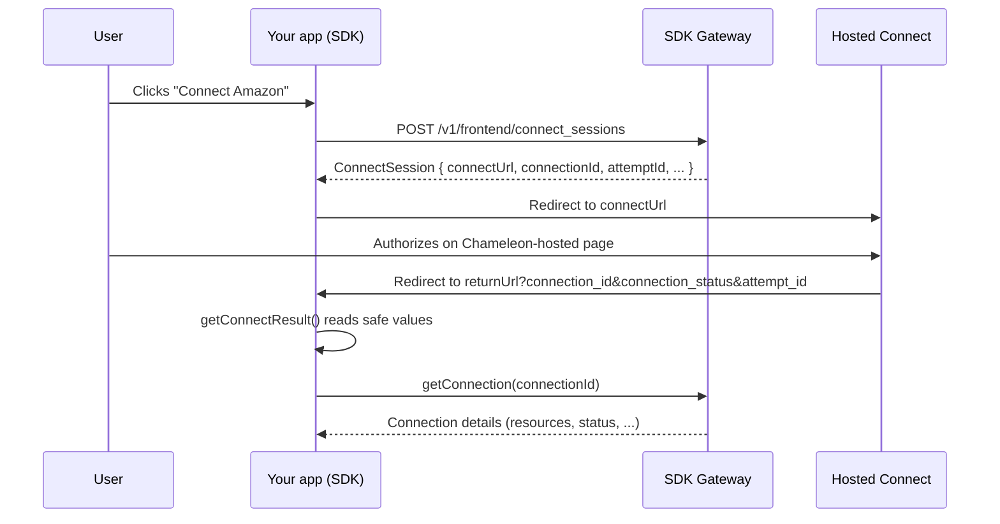

# Chameleon JavaScript SDK

A private, browser-safe JavaScript SDK that lets your web app start and manage
marketplace connections through **Chameleon**. Your application integrates only
this package — OAuth / LWA, callbacks, access & refresh tokens, and all
marketplace request signing stay hosted inside Chameleon and never touch the
browser.

```bash
npm install @chameleon/sdk
```

```js
import { createChameleonClient } from "@chameleon/sdk";

const chameleon = createChameleonClient({
  publishableKey: "pk_live_...",
  getSessionToken: () => app.chameleonSession.getToken(),
});

document.querySelector("#connect-amazon").addEventListener("click", async () => {
  await chameleon.connect({
    provider: "amazon",
    organizationId: currentWorkspace.id,
    returnUrl: "https://app.example.com/integrations",
  });
});
```

---

## Table of contents

- [What this SDK is (and is not)](#what-this-sdk-is-and-is-not)
- [Architecture](#architecture)
- [The connect flow](#the-connect-flow)
- [Installation](#installation)
- [Quick start](#quick-start)
- [Client options](#client-options)
- [API reference](#api-reference)
- [Supported marketplaces](#supported-marketplaces)
- [Error handling](#error-handling)
- [Security model](#security-model)
- [Platform integration (backend contract)](#platform-integration-backend-contract)
- [TypeScript](#typescript)
- [Development](#development)
- [Requirements](#requirements)

---

## What this SDK is (and is not)

This SDK is a thin client for a **Chameleon SDK Gateway** — a Chameleon-hosted
*frontend* API, in the same spirit as the browser SDKs shipped by hosted
authentication platforms.

**It is:**

- A browser-safe client that identifies your environment with a **Publishable
  Key** (`pk_...`).
- A way to open **Hosted Connect**, the Chameleon-hosted page where a user
  authorizes a marketplace.
- A small set of UI operations to read, select resources on, reconnect, and
  disconnect connections.

**It is not:**

- A public integration API. It never uses a **Secret Key** and refuses one at
  construction time.
- A client for marketplace provider operations (listing products, orders,
  fulfilment, etc.). Those live behind Chameleon's server-side APIs.
- A holder of any marketplace secret. LWA tokens, refresh tokens, and Amazon
  credentials never reach the browser.

Every request the browser makes is authorized server-side by three things: a
valid Publishable Key, a valid **Chameleon session**, and the caller's
**workspace RBAC**. CORS is restricted to the product origins Chameleon allows.

---

## Architecture

The SDK only ever talks to the **SDK Gateway** (the `/v1/frontend/*` surface).
Everything sensitive — provider OAuth, token storage, request signing — stays
server-side in Chameleon.



Request authentication, set by the SDK on every gateway call:

| Header | Value | Purpose |
| --- | --- | --- |
| `authorization` | `Bearer <publishableKey>` | Identifies the environment |
| `x-chameleon-session` | current session proof | Identifies the signed-in user / workspace |
| `x-chameleon-sdk` | `@chameleon/sdk-js/<version>` | Client identification |
| `idempotency-key` | random per mutation | Safe retries on `POST` requests |

The gateway base URL defaults to `https://api.chameleon.dev` and can be
overridden with `apiBaseUrl` (handy for staging and tests).

### Package layout

```
src/
  index.js    # public entry — re-exports the client factory and error class
  client.js   # ChameleonClient: validation, auth headers, requests, redirects
  errors.js   # ChameleonSdkError (status / code / message / requestId)
index.d.ts    # TypeScript types for the public surface
test/
  client.test.js
```

The package is pure **ESM**, has **no runtime dependencies**, and is marked
`sideEffects: false` so it tree-shakes cleanly.

---

## The connect flow

A full marketplace connection is a hosted, redirect-based flow. The SDK handles
the browser half; Chameleon handles authorization and secrets.



1. **Start.** `connect()` creates a connection attempt and redirects the browser
   to `connectUrl` (Hosted Connect).
2. **Authorize.** The user grants access on the Chameleon-hosted page. No
   marketplace credentials pass through your app.
3. **Return.** Chameleon redirects back to your `returnUrl` with only safe query
   params: `connection_id`, `connection_status`, `attempt_id`.
4. **Resolve.** On the return page, `getConnectResult()` reads those params and
   you fetch the final state with `getConnection()`.

---

## Installation

```bash
npm install @chameleon/sdk
```

Requires **Node.js ≥ 18** for tooling and a `fetch`-capable runtime (any modern
browser, or Node 18+). In non-browser environments you must supply `fetch` and
`navigate` yourself — see [Client options](#client-options).

---

## Quick start

### 1. Create a client

```js
import { createChameleonClient } from "@chameleon/sdk";

const chameleon = createChameleonClient({
  publishableKey: "pk_live_...",
  // Return the current Chameleon session proof. Called before every request,
  // so it always reflects the signed-in user.
  getSessionToken: () => app.chameleonSession.getToken(),
});
```

### 2. Start a connection

```js
await chameleon.connect({
  provider: "amazon",
  organizationId: currentWorkspace.id,
  returnUrl: "https://app.example.com/integrations",
});
// Redirects to Hosted Connect. The session, Publishable Key, and workspace
// permissions are verified server-side before an attempt is created.
```

### 3. Handle the return URL

On the page served at your `returnUrl`:

```js
const result = chameleon.getConnectResult();
// -> { connectionId, connectionStatus, attemptId }

if (result.connectionStatus === "connected") {
  const connection = await chameleon.getConnection(result.connectionId);
  // Show the connected marketplace, its resources, etc.
}
```

### 4. Manage the connection

```js
const connection = await chameleon.getConnection(result.connectionId);

// Let the user pick which marketplaces/resources to sync.
if (connection.resources.some((resource) => !resource.selected)) {
  await chameleon.selectResources(connection.id, [
    "amazon:seller:marketplace:ATVPDKIKX0DER",
  ]);
}

await chameleon.reconnect(connection.id);  // re-open Hosted Connect
await chameleon.disconnect(connection.id); // remove the connection
```

---

## Client options

Pass these to `createChameleonClient(options)` (or `new ChameleonClient(options)`).

| Option | Type | Required | Default | Description |
| --- | --- | --- | --- | --- |
| `publishableKey` | `string` | ✅ | — | Your environment's publishable key (`pk_...`). Must be non-empty. |
| `getSessionToken` | `() => string \| Promise<string>` | ✅ | — | Returns the current Chameleon session proof. Called before every request. |
| `apiBaseUrl` | `string` | — | `https://api.chameleon.dev` | SDK Gateway base URL. A trailing slash is stripped. |
| `fetch` | `typeof fetch` | — | `globalThis.fetch` | Custom fetch implementation (required if the runtime has no global `fetch`). |
| `navigate` | `(url: string) => void` | — | `location.assign` | How redirects to Hosted Connect are performed. Override for SPAs, tests, or non-browser hosts. |

> **Note:** Passing `secretKey` throws immediately — this client is browser-safe
> by design. See [Security model](#security-model).

---

## API reference

All methods are `async` unless noted. Mutating calls (`POST`) automatically send
an `idempotency-key` so retries are safe.

### `connect(input): Promise<ConnectSession>`

Convenience method for a "Connect" button: creates a connect session **and**
redirects the browser to Hosted Connect. Returns the session before navigating.

```ts
input: {
  provider: "amazon";
  organizationId: string;
  returnUrl: string;
}
```

### `createConnectSession(input): Promise<ConnectSession>`

Same as `connect()` but **does not** redirect. Use it when you want to control
navigation yourself (e.g. open `connectUrl` in a popup or a new tab).

```ts
ConnectSession = {
  id: string;
  attemptId: string;
  connectionId: string;
  connectUrl: string;   // Hosted Connect URL
  expiresAt: string;    // ISO 8601
  state: string;        // e.g. "awaiting_authorization"
  nextAction: string;   // e.g. "redirect"
}
```

### `getConnection(connectionId): Promise<object>`

Fetches a connection and its current state (status, resources, …).

### `getAttempt(attemptId): Promise<object>`

Fetches a single connection attempt — useful for polling an in-progress flow.

### `selectResources(connectionId, resourceIds): Promise<object>`

Selects which resources (e.g. Amazon marketplaces) a connection should use.
`resourceIds` must be a non-empty array of non-empty strings.

### `reconnect(connectionId): Promise<ConnectSession>`

Re-opens Hosted Connect for an existing connection (for example, after a
revoked authorization) and redirects the browser, like `connect()`.

### `disconnect(connectionId): Promise<object>`

Disconnects (removes) a connection.

### `cancelAttempt(attemptId): Promise<object>`

Cancels an in-progress connection attempt.

### `getConnectResult(url?): ConnectionResult`

**Synchronous.** Parses the safe values Chameleon appends to your `returnUrl`
after Hosted Connect. Defaults to `location.href`.

```ts
ConnectionResult = {
  connectionId: string | null;
  connectionStatus: string | null;
  attemptId: string | null;
}
```

---

## Supported marketplaces

| Marketplace | Provider ID | Status | Current capabilities |
| --- | --- | --- | --- |
| Amazon SP-API US | `amazon` | **Available** | Connect, Hosted Connect, marketplace discovery, optional selection, reconnect, disconnect |
| eBay | `ebay` | Planned | Adapter not yet enabled |
| TikTok Shop | `tiktok_shop` | Planned | Adapter not yet enabled |
| Temu | `temu` | Planned | Adapter not yet enabled |
| Walmart Marketplace | `walmart` | Planned | Adapter not yet enabled |

In this build, `connect()` accepts only `provider: "amazon"`. The other IDs are
reserved in Chameleon, but using one before its adapter is enabled returns a
"provider unavailable" error.

---

## Error handling

Failed gateway requests reject with a `ChameleonSdkError`. Provider credentials
are never included in errors.

```js
import { ChameleonSdkError } from "@chameleon/sdk";

try {
  await chameleon.connect({
    provider: "amazon",
    organizationId: currentWorkspace.id,
    returnUrl: "https://app.example.com/integrations",
  });
} catch (error) {
  if (error instanceof ChameleonSdkError) {
    console.error(error.code, error.status, error.requestId);
    // e.g. "AMAZON_AUTHORIZATION_DENIED" 403 "req_..."
  } else {
    throw error; // input validation (plain Error), network, etc.
  }
}
```

| Property | Type | Description |
| --- | --- | --- |
| `status` | `number` | HTTP status returned by the gateway |
| `code` | `string` | Stable error code (see below) |
| `message` | `string` | Human-readable message |
| `requestId` | `string \| undefined` | `x-request-id` for support / tracing |

**SDK-level codes**

| Code | Status | When |
| --- | --- | --- |
| `CHAMELEON_SESSION_MISSING` | 401 | `getSessionToken()` returned an empty value |
| `CHAMELEON_API_ERROR` | varies | Gateway error without a specific code |
| `CHAMELEON_API_INVALID_RESPONSE` | varies | Gateway returned invalid JSON |

The gateway may also return provider/domain codes such as
`AMAZON_AUTHORIZATION_DENIED`. Note that invalid arguments (missing
`publishableKey`, bad `provider`, empty `resourceIds`, …) throw a plain `Error`
synchronously, before any request is made — and `reconnect()` / `connect()`
never navigate when the underlying request fails.

---

## Security model

This SDK is built to run safely in untrusted browser contexts.

- **Publishable key only.** It identifies the environment; it is not a secret.
- **No secret key, ever.** Passing `secretKey` throws at construction.
- **Nothing sensitive passes through.** Do **not** send `sk_...` keys, Amazon
  credentials, LWA tokens, or refresh tokens to this SDK. They belong only in
  Chameleon's server-side services.
- **Server-side authorization.** Every request is validated against a live
  Chameleon session and workspace RBAC before anything happens.
- **Minimal return surface.** Only `connection_id`, `connection_status`, and
  `attempt_id` come back to the browser via the return URL.

---

## Platform integration (backend contract)

For this SDK to work, Chameleon must expose the matching gateway. The platform
side is responsible for:

- Mounting the internal endpoints under **`/v1/frontend/*`**.
- Validating the **Publishable Key + Chameleon session** on every request.
- Applying the **`WorkspaceAuthorizer`** (workspace RBAC).
- Configuring **CORS** for the allowed product origins only.

This contract is implemented by the main `chameleon-sdk` package via
`createAmazonHostedApi`. The browser SDK in this repository is the client half
of that contract.

---

## TypeScript

Type definitions ship with the package (`index.d.ts`) and are picked up
automatically — no `@types` package required.

```ts
import {
  createChameleonClient,
  ChameleonClient,
  ChameleonSdkError,
  type ChameleonClientOptions,
  type ConnectMarketplaceInput,
  type ConnectSession,
  type ConnectionResult,
} from "@chameleon/sdk";
```

---

## Development

```bash
npm test      # run the Node.js test suite (node --test test/*.test.js)
npm run check # syntax-check the source files (node --check)
```

The tests inject a fake `fetch` and `navigate`, so they run with no network
access and assert the gateway contract directly — that `connect()` opens Hosted
Connect, that failures surface as `ChameleonSdkError` without navigating, that
return-URL parsing stays minimal, and that a `secretKey` is rejected.

---

## Requirements

- **Node.js ≥ 18** (for tooling and the test runner).
- A `fetch`-capable runtime at execution time — a modern browser, or Node 18+.
  Outside a browser, provide `fetch` and `navigate` via client options.

---

## License

`UNLICENSED` — private package. Not for public distribution.
